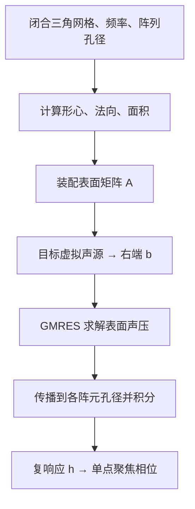

# BEM 求解器

## 1. 相对原 PDE 的优势

| 比较项 | 原 PDE | BEM |
|---|---|---|
| 求解对象 | 整个三维空间的声压 | 障碍物表面声压 |
| 求解方式 | 体积网格离散 + 稀疏线性求解 | 边界积分 + 数值迭代 |
| 开放空间 | 有限域 + 开放边界／PML | Green 函数直接描述出射传播，无需 PML |
| 障碍物表示 | SDF 材料场 | 三角表面网格，无需体积材料过渡带 |
| 几何移动 | 更新材料场和矩阵 | 刚体运动可复用自相互作用矩阵 |
| 目标响应 | 体积求解或适用条件下的凝聚求解 | 每个目标一次表面求解，获取全部阵元响应 |
| 主要限制 | 大域细网格的计算和存储成本高 | 当前仅支持刚性物体；矩阵稠密 |

体积与表面未知量分别按 \(V/h^3\)、\(S/h^2\) 增长。BEM 减少了需要离散的区域，但其稠密矩阵存储仍为 \(O(N_s^2)\)。PDE 在固定场景下也能复用分解、响应基和缓存。

## 2. 数学原理与实际求解

### 2.1 要求解的物理问题

采用时间约定 \(p(\mathbf x,t)=\operatorname{Re}[p(\mathbf x)e^{-i\omega t}]\)。均匀空气中，声源之外满足：

$$
(\nabla^2+k^2)p=0,\qquad k=\frac{\omega}{c}.
$$

障碍物表面为 \(S\)，法向 \(\mathbf n\) 从物体指向空气。当前障碍物采用刚性条件：

$$
\frac{\partial p}{\partial n}=0\quad\text{on }S.
$$

这表示表面法向速度为零，**不表示表面声压为零**。将总场分成已知入射场与未知散射场：

$$
p=p_{\mathrm{inc}}+p_{\mathrm{scat}}.
$$

入射场是在没有障碍物、保留声源和挡板时的声场；待求量是障碍物引起的散射，以及表面总声压 \(u=p|_S\)。

### 2.2 用 Green 恒等式消去体积未知量

出射 Green 函数是单位点源的解析传播解：

$$
G(\mathbf x,\mathbf y)=\frac{e^{ikR}}{4\pi R},
\qquad R=|\mathbf x-\mathbf y|,
\qquad(\nabla_{\mathbf x}^2+k^2)G=-\delta(\mathbf x-\mathbf y).
$$

\(1/R\) 描述几何扩散，\(e^{ikR}\) 描述传播相位。对于 \(z=0\) 的无限刚性挡板，加入同号镜像源：

$$
G_h(\mathbf x,\mathbf y)=G(\mathbf x,\mathbf y)+G(\mathbf x,\mathbf y^\ast).
$$

这个核同时满足挡板的零法向导数和向无穷远传播的辐射条件。

对外部声场应用 Green 第二恒等式，可以把体积方程改写为边界表示：

$$
p(\mathbf x)=p_{\mathrm{inc}}(\mathbf x)+
\int_S\left[
p(\mathbf y)\frac{\partial G_h}{\partial n_{\mathbf y}}
-G_h\frac{\partial p(\mathbf y)}{\partial n_{\mathbf y}}
\right]\mathrm dS_{\mathbf y}.
$$

代入刚性条件，第二项消失：

$$
\boxed{
p(\mathbf x)=p_{\mathrm{inc}}(\mathbf x)+
\int_S u(\mathbf y)\frac{\partial G_h(\mathbf x,\mathbf y)}
{\partial n_{\mathbf y}}\,\mathrm dS_{\mathbf y}
}.
$$

**均匀空气中的传播已包含在解析核里，剩下只需确定表面函数 \(u\)。** 表面积分包含各面元之间的耦合，能够表示多次散射，并非把每个面元当作互不影响的反射点。

### 2.3 在表面建立封闭方程

上式仍包含未知的 \(u\)。让观测点从空气侧趋近表面，双层位势产生跳跃项：

$$
u=p_{\mathrm{inc}}+\left(\frac12I+K\right)u
\quad\Longrightarrow\quad
\left(\frac12I-K\right)u=p_{\mathrm{inc}}|_S.
$$

\(K\) 是双层积分的主值算子，\(\frac12I\) 来自边界极限；当前配点位于平面三角形内部，采用这一系数。

再对场表示取法向导数，得到：

$$
Hu=-\frac{\partial p_{\mathrm{inc}}}{\partial n},
$$

其中 \(H\) 是双层位势的法向导数，即超奇异积分算子。主后端使用 Burton–Miller 组合：

$$
\boxed{
\left(\frac12I-K-\alpha H\right)u
=p_{\mathrm{inc}}+\alpha\frac{\partial p_{\mathrm{inc}}}{\partial n},
\qquad \alpha=\frac{i}{k}
}.
$$

组合声压和法向导数方程，用于消除单独积分方程在某些频率下出现的虚假内部共振。

### 2.4 三角面元离散成矩阵

将表面分为 \(N\) 个三角面元 \(S_j\)，每个面元内用一个常数复声压 \(u_j\) 近似：

$$
u(\mathbf y)\approx\sum_{j=1}^{N}u_j\chi_{S_j}(\mathbf y).
$$

在面元形心 \(\mathbf x_i\) 上配点，得到：

$$
K_{ij}=\int_{S_j}
\frac{\partial G_h(\mathbf x_i,\mathbf y)}{\partial n_{\mathbf y}}\,\mathrm dS,
\qquad
H_{ij}=\operatorname{f.p.}\int_{S_j}
\frac{\partial^2G_h(\mathbf x_i,\mathbf y)}
{\partial n_{\mathbf x_i}\partial n_{\mathbf y}}\,\mathrm dS.
$$

对奇异项采用相应主值／有限部分解释，最终形成：

$$
A_{ij}=\frac12\delta_{ij}-K_{ij}-\alpha H_{ij},
\qquad
b_i=p_{\mathrm{inc}}(\mathbf x_i)
+\alpha\,\mathbf n_i\cdot\nabla p_{\mathrm{inc}}(\mathbf x_i),
\qquad
\boxed{A\mathbf u=\mathbf b}.
$$

矩阵第 \(i\) 行表示第 \(i\) 个面元上的边界条件，第 \(j\) 列表示第 \(j\) 个面元对各处的影响。因此 \(A\in\mathbb C^{N\times N}\) 通常是稠密矩阵。

当前装配采用 CUDA 积分核：远面元用低阶求积，近面元细分后积分；原物体同一平面面元的双层自作用项为零，超奇异自作用项单独做有限部分处理。镜像贡献另行积分。

### 2.5 用 GMRES 求表面声压

GMRES 通过反复计算 \(A\mathbf v\)，在逐步扩展的 Krylov 子空间中选择残差最小的近似解。无需显式计算 \(A^{-1}\)，停止条件为：

$$
\frac{\|\mathbf b-A\mathbf u\|_2}{\|\mathbf b\|_2}\leq\varepsilon.
$$

主 BEM 常用 \(\varepsilon=10^{-5}\)，手部运动性能实验使用 \(10^{-3}\)。实现记录收敛状态，并检查真实残差；达到迭代上限不等于收敛。

对任意外部采样点，计算传播行向量：

$$
D_j(\mathbf x)=\int_{S_j}
\frac{\partial G_h(\mathbf x,\mathbf y)}{\partial n_{\mathbf y}}\,\mathrm dS,
\qquad
p(\mathbf x)=p_{\mathrm{inc}}(\mathbf x)+\sum_jD_j(\mathbf x)u_j.
$$

只查询目标点就只计算这些点；输出全场时再对全部采样点求值。低线性残差不保证表面网格和积分精度，仍需加密验证。

### 2.6 互易求解：一次获得 256 通道响应

令 \(h_j(\mathbf x_t)\) 表示第 \(j\) 个阵元以单位幅值激励时，在目标 \(\mathbf x_t\) 产生的复声压。利用线性互易声学，交换激励和接收位置：

1. 在目标 \(\mathbf x_t\) 放置虚拟单位点源，构造入射场 \(q_{\mathrm{inc}}(\mathbf x)=G_h(\mathbf x,\mathbf x_t)\)。
2. 根据该入射场构造 \(\mathbf b_t\)，求解 \(A\mathbf u_t=\mathbf b_t\)。这里 \(\mathbf u_t\) 是**虚拟目标源**激励下的表面声压。
3. 将求得的场传播到全部阵元孔径，再按各孔径的源分布积分：

$$
h_j(\mathbf x_t)=2\pi\int_{\Gamma_j}
f_a(\mathbf s)\,q(\mathbf s;\mathbf x_t)\,\mathrm dS
\approx2\pi\sum_{\ell}w_{j\ell}
\left[G_h(\mathbf s_{j\ell},\mathbf x_t)
+\sum_mD_m(\mathbf s_{j\ell})u_{t,m}\right].
$$

\(\Gamma_j\) 是阵元孔径，\(f_a\) 为单位积分的 sinc-Neumann 孔径分布，\(w_{j\ell}\) 已包含该分布与积分权重；\(2\pi\) 来自项目声源归一化。方括号内分别为直达场和散射场。

因此单个目标只解一次表面系统，之后做 256 个孔径的求值与积分。互易性本身也可用于 PDE；这里的收益来自它与较小的表面系统结合。

若阵元幅值 \(a_j\) 固定，目标总场为：

$$
p(\mathbf x_t)=\sum_j a_jh_j e^{i\phi_j}.
$$

选择 \(\phi_j=-\arg h_j+\phi_0\)，可使各项同相，达到单点幅值上限 \(\sum_j a_j|h_j|\)。多焦点或旁瓣控制还需单独优化。

### 2.7 实际调用顺序与运动复用

| 步骤 | 当前代码入口 | 主要工作 |
|---|---|---|
| 几何准备 | `RigidBEM.update_geometry()` | 计算面元几何和自作用项 |
| 矩阵装配 | `RigidBEM.assemble()` | 汇总物体本身与镜像的积分贡献 |
| 入射场与右端 | `point_source()`、`rhs()` | 计算虚拟源声压及法向导数 |
| 线性求解 | `RigidBEM.solve()` | GMRES 矩阵向量乘与残差检查 |
| 响应计算 | `aperture_response()` | 叠加直达／散射场并积分孔径 |
| 连续帧 | `FocusSession` | 复用矩阵部分与上一帧解，生成相位 |

对同一物体的整体刚体运动，可分解：

$$
A=A_{\mathrm{self}}+A_{\mathrm{image}}.
$$

物体内部的相对距离和方向关系不变，\(A_{\mathrm{self}}\) 可复用；物体与固定挡板镜像的相对关系变化，需要更新 \(A_{\mathrm{image}}\)、入射场与孔径传播。多个物体独立运动时，物体之间的耦合也会变化。

上一帧表面解可作为下一帧 GMRES 的初值；当前实现还用新旧入射场之比逐面元修正初值。手指弯曲改变内部几何关系，需要重新装配。

### 2.8 效率来源

- **表面降维：** 不为均匀空气分配体积未知量，也不铺 PML；但矩阵装配与存储仍约为 \(O(N^2)\)。
- **按需求值：** 单点聚焦不构建完整三维场；每个目标只做一次表面求解，再计算全部孔径。
- **GPU 与复用：** 稠密矩阵向量乘并行执行，刚体自作用矩阵和上一帧解可复用。

若 GMRES 迭代 \(m\) 次，矩阵向量乘成本约为 \(O(mN^2)\)，另有正交化和积分求值成本。相对 PDE 的收益取决于物体面积、频率、目标数和精度要求，不能仅凭降维就推断固定加速倍数。

## 3. 实测结果

环境：RTX 4090 24 GB、i9-13900K、64 GB 内存，40 kHz。BEM 与 PDE 使用相同的 sinc-Neumann 孔径声源。

### 精度验证

| 实验 | 结果 |
|---|---|
| 刚性球与解析解对比 | 面元从 1,280 增至 20,480，场误差从 **3.8% 降至 0.33%** |
| 自由场，8 个目标，与 1/3 mm PDE 网格对比 | 最优幅值差约 **0.44%–0.54%**；去整体相位后，平均相位差约 **0.7°–2.4°** |
| 自由场，将 BEM 相位放入 PDE | 达到各目标 PDE 最优幅值的 **99.947%–99.986%** |

带球障碍物的小场景中，PDE 从 \(47^3\) 加密至 \(93^3\)，两模型的总场相对差从 **58.3% 降至 28.0%**。差异仍明显，涉及体积网格色散和 SDF 材料过渡带；不能据自由场结果宣称任意障碍物场景都已对齐。

### 完整 256 阵元与手部

约 17 cm 的刚性手部网格，固定焦点，手整体移动。聚焦幅值比以 \(\lambda/6\)、29,062 面元的 BEM 为参考。

| 表面网格 | 面元数 | 首帧 | 刚体移动帧 | 参考模型中的聚焦幅值比 |
|---|---:|---:|---:|---:|
| \(\lambda/4\) | 12,914 | 147 ms | **79–90 ms** | **99.88%** |
| \(\lambda/5\) | 20,180 | 311 ms | 163–194 ms | 99.98% |

- 20,180 面元、256 阵元、约 26.1 万空间采样点的完整响应基：**76.8 s**。
- 同一手部场景中，忽略手部散射的相位仅达到最优焦点幅值的 **89.1%**。
- \(\lambda/4\) 刚体更新约 **11–13 Hz**；手指弯曲需整体重装矩阵，不能沿用刚体复用耗时。

另一个完整阵列加球障碍物的 PDE 测试中，约 323 万体积节点已使所测直接法因分解资源需求失败；默认预条件 GMRES 也未达到收敛门槛。这表明当前所测配置存在资源瓶颈，不代表所有 PDE 方法都无法求解。

## 4. 适用范围

- **适合 BEM：** 均匀空气中的封闭刚性障碍物、大阵列目标响应、障碍物刚体运动。
- **仍使用 PDE：** 变密度、变声速、材料透射、阻抗边界和材料反演。
- 当前 BEM 不支持开放薄屏、吸收／弹性物体和两面平行无限反射墙；表面加密仍会增加稠密矩阵成本。
- 以上为数值验证与计算端计时，尚非实物声压或硬件闭环结果；聚焦幅值比不代表全场精度，当前尚未达到 100 Hz。

数据与复现入口：[BEM 实验报告](BEM_REALTIME_FOCUSING.md) · [手部配置](../src/examples/bem_hand_16x16.yaml) · [PDE 模型与验证](PDE_MATERIAL_BOUNDARY_REPAIR.md)。

实现对应：[表面求解器](../src/algorithm/bem/solver.py) · [积分核](../src/algorithm/bem/kernels.py) · [GMRES](../src/algorithm/bem/krylov.py) · [互易求解与运动复用](../src/algorithm/bem/realtime.py)。
